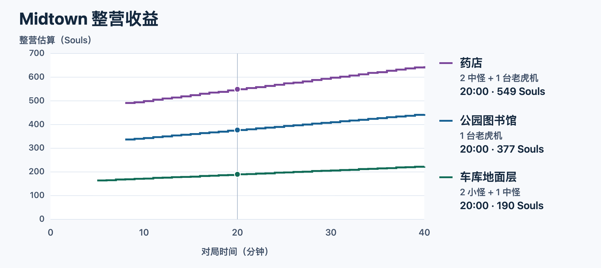

# Midtown Camp Souls

[简体中文](README.md)

A Deadlock minimap mod for Midtown. Hold `Tab` to see estimated full-camp Souls for Haunts, Sinner’s Sacrifice machines, and mixed camps. Two icons in the upper-left corner show the value of one standard trooper wave and the payout from one ordinary crate that drops Souls. At 20:00, they read `560` and `58` Souls, respectively.

Both preview packages have passed offline checks. In-game rendering and hover behavior still need live testing. [GitHub Releases](https://github.com/cy2s/deadlock-camp-souls/releases)

## Download and install

| Variant | While holding Tab | Download |
| --- | --- | --- |
| Tab | Shows estimates for camps the game marks as active | [Tab ZIP](https://github.com/cy2s/deadlock-camp-souls/releases/download/v0.1.3-preview/midtown-camp-souls-tab-preview.zip) |
| Experimental hover | Shows the estimate when the pointer is over a native camp icon | [Hover ZIP](https://github.com/cy2s/deadlock-camp-souls/releases/download/v0.1.3-preview/midtown-camp-souls-hover-preview.zip) |

1. Close Deadlock and choose one ZIP. Disable any previous version before upgrading.
2. Open `Mods Library → Add Local Mod` in Deadlock Mod Manager. Import the ZIP and enable it.
3. Start a custom match on Midtown and hold `Tab`. Both variants show the trooper-wave icon. The crate icon appears at 3:00. [Mod Manager import guide](https://docs.deadlockmods.app/using-mod-manager/library#add-local-mods)

For manual installation, extract `pak99_dir.vpk` to `Deadlock/game/citadel/addons/`. If another mod already uses that filename, choose an unused `pakNN_dir.vpk` name. On a first manual install, add `Game citadel/addons` before `Game citadel` in the `SearchPaths` block of `gameinfo.gi`. To uninstall, disable the mod in the manager or remove its VPK. [Manual installation guide](https://wiki.divineskins.gg/en/docs/deadlock/getting-started/install-by-hand)

## Full-camp rewards over time

The chart uses build 6873 reward data and starts each curve at the camp’s first spawn. Mixed camps combine Haunt and Sinner’s Sacrifice rewards.



The interactive chart has 15 selectable camps and shows estimates by match minute. The chart labels are in Chinese. Download the HTML and open it in a browser with an internet connection. [Download the interactive chart](https://github.com/cy2s/deadlock-camp-souls/releases/download/v0.1.2-preview/camp-rewards.html)

## How the estimates work

| Source | Estimate |
| --- | --- |
| Haunts | Small, medium, and large Haunts start at `43 / 71 / 189` Souls each. Every full match minute adds `1.08%` of the base. Each Haunt’s reward is rounded down before summing. |
| Sinner’s Sacrifice | Each machine starts at `155 × 2 = 310` Souls for all hits and the final break combined. The same `1.08%` growth applies, with each machine’s total rounded to the nearest integer. |
| Trooper wave (helmets icon) | One standard wave of four troopers is worth `4 × (100 + 2 × full match minutes)` before Soul sharing or missed pickups. At 20:00, the estimate is `560`. |
| Ordinary crate (wooden crate icon) | A single crate that drops Souls pays `18 + 2 × full match minutes`. This is `24` at 3:00 and `58` at 20:00. The configured Soul drop chance is `60%`. |

Camp labels estimate the full roster. They follow the game’s active minimap markers and hide after a camp is cleared until its marker returns. Actual payouts vary with remaining units, Soul sharing, and rounding. Small, medium, and large camps use green, yellow, and light red. Purple marks camps that include Sinner’s Sacrifice. [NPC data](https://github.com/SteamTracking/GameTracking-Deadlock/blob/5af9a052650ea6f47437041cbca686d88d8913d0/game/citadel/pak01_dir/scripts/npc_units.vdata) · [Sinner’s Sacrifice payouts](https://deadlock.wiki/Sinner%27s_Sacrifice#Souls) · [Crate drop chance](https://github.com/SteamTracking/GameTracking-Deadlock/blob/5af9a052650ea6f47437041cbca686d88d8913d0/game/citadel/pak01_dir/scripts/misc.vdata#L134-L154) · [Crate reward](https://github.com/SteamTracking/GameTracking-Deadlock/blob/5af9a052650ea6f47437041cbca686d88d8913d0/game/citadel/pak01_dir/scripts/misc.vdata#L1289-L1290) · [Trooper rewards and wave size](https://github.com/SteamTracking/GameTracking-Deadlock/blob/5af9a052650ea6f47437041cbca686d88d8913d0/DumpSource2/convars.txt#L5263-L5348)

### Missing readouts

- The crate readout starts at 3:00. The wave, crate, and camp labels hide when the mod cannot read the match clock.
- Camp labels require an active native marker that maps to exactly one known camp. The hover variant also requires the icon’s native hover state.
- If another mod replaces `hud_minimap.vxml_c`, try enabling this mod by itself. Running both requires merging the layouts.

## Build locally

Use Python 3.10 or later. The build script downloads the stock minimap layout from build 6871 by default. Use `--minimap-layout PATH` to pass a local decompiled copy.

```sh
python3 build.py               # dist/pak99_dir.vpk
python3 build.py --hover-only  # dist/hover/pak99_dir.vpk
```

`camps.json` matches 51 camp locations with their rosters by map ID. Each `counts` array lists small Haunts, medium Haunts, large Haunts, and Sinner’s Sacrifice machines in that order. When updating for a game build, check the reward settings, map coordinates, and stock HUD layout. [Map coordinates](https://api.deadlock-api.com/v1/assets/map?client_version=6871) · [Camp rosters](https://deadlockvault.net/map/camps) · [Stock minimap layout](https://github.com/SteamTracking/GameTracking-Deadlock/blob/77b862290ad3050cafd2e9c3f47e0532e9d6dcfd/game/citadel/pak01_dir/panorama/layout/hud_minimap.xml)

Source 2 Viewer verified and unpacked both VPKs. Simulated HUD states covered wave and crate readouts, camp clears and respawns, Tab visibility, and hover selection. Native marker visibility, hover, zoom, and team-side flipping still need in-game testing.
