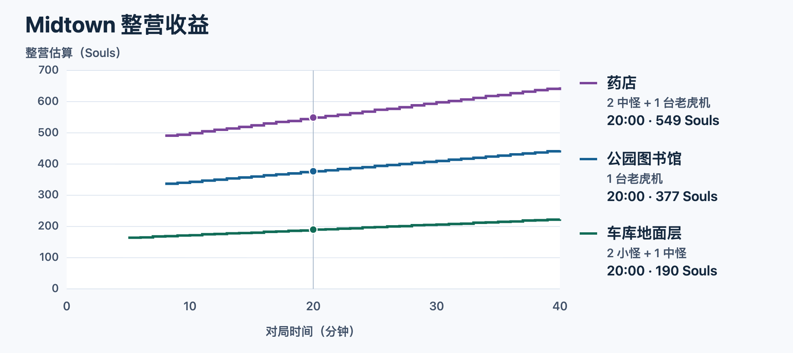

# Midtown Camp Souls

[English](README.en.md)

Deadlock 小地图 Mod。按住 `Tab`，查看 Midtown 野怪、老虎机和混合营地的满营 Souls 估算。地图左上侧用图标显示一波普通兵线和一个普通箱出魂时的金额。20:00 的数值分别为 `560` 和 `58`。

两个预览安装包均已通过离线校验，游戏内显示和悬停仍待实测。 [GitHub Releases](https://github.com/cy2s/deadlock-camp-souls/releases)

## 下载与安装

| 版本 | 按住 Tab 时 | 下载 |
| --- | --- | --- |
| Tab 版 | 显示游戏已标为刷新的营地收益 | [Tab ZIP](https://github.com/cy2s/deadlock-camp-souls/releases/download/v0.1.4-preview/midtown-camp-souls-tab-preview.zip) |
| 悬停试验版 | 鼠标移到原生营地图标时，显示该点位收益 | [Hover ZIP](https://github.com/cy2s/deadlock-camp-souls/releases/download/v0.1.4-preview/midtown-camp-souls-hover-preview.zip) |

1. 退出 Deadlock，任选一个 ZIP。升级时先停用旧版。
2. 在 Deadlock Mod Manager 打开 `Mods Library → Add Local Mod`，导入 ZIP 并启用。
3. 启动游戏，在 Midtown 自定义对局按住 `Tab` 查看。两个版本都会显示烛头小兵图标，3:00 起再显示木箱图标。 [管理器导入说明](https://docs.deadlockmods.app/using-mod-manager/library#add-local-mods)

**手动安装**时，将 ZIP 中的 `pak99_dir.vpk` 放入 `Deadlock/game/citadel/addons/`。若已有同名的其他模组，给本包选一个空闲的 `pakNN_dir.vpk` 文件名。首次手装时，按指南将 `Game citadel/addons` 加到 `gameinfo.gi` 的 `SearchPaths`，放在 `Game citadel` 前。卸载时在管理器停用或移除本包的 VPK。 [手动安装指南](https://wiki.divineskins.gg/en/docs/deadlock/getting-started/install-by-hand)

## 野怪和老虎机整营收益

按当前版本（build 6875）的数据估算整营 Souls。曲线从营地首次刷新的时间开始，混合营地按野怪与老虎机收益相加。



交互版包含 **15 个点位**，可切换营地、查看每分钟的估算值。下载后用浏览器联网打开。 [下载交互图 HTML](https://github.com/cy2s/deadlock-camp-souls/releases/download/v0.1.2-preview/camp-rewards.html)

## 地图读数怎么算

| 来源 | 当前估算口径 |
| --- | --- |
| 野怪 | 小、中、大怪单只基础值为 `43 / 71 / 189`。按对局整分钟每分钟增加基础值的 `1.08%`，单只向下取整后累加。 |
| 老虎机 | 单台把敲击与打碎的两部分合计，基础满额为 `155 × 2 = 310`。按相同的 `1.08%` 增长，单台总额取近似整数。 |
| 兵线（烛头小兵图标） | 一波 4 只普通小兵全收为 `4 × (100 + 2 × 对局整分钟)`。20:00 为 `560`，是单人全收的参考值。 |
| 普通箱（木箱图标） | 单个箱子出魂时为 `18 + 2 × 对局整分钟`，3:00 为 `24`，20:00 为 `58`。此类箱子的配置掉落概率为 `60%`。 |

营地数字以完整阵容估算。清空到重刷之间，数字跟随游戏的原生营地标记隐藏。实际到账会随剩余数量、分配和逐次取整变化。绿色、黄色、浅红色对应小、中、大营地，紫色代表含老虎机的点位。兵线和普通箱是地图侧边的参考值。 [NPC 数据](https://github.com/SteamTracking/GameTracking-Deadlock/blob/6d9ccf2531f8b097e7b97908765eda6f1b501de1/game/citadel/pak01_dir/scripts/npc_units.vdata) · [老虎机结算规则](https://deadlock.wiki/Sinner%27s_Sacrifice#Souls) · [普通箱掉落](https://github.com/SteamTracking/GameTracking-Deadlock/blob/6d9ccf2531f8b097e7b97908765eda6f1b501de1/game/citadel/pak01_dir/scripts/misc.vdata#L134-L154) · [普通箱金额](https://github.com/SteamTracking/GameTracking-Deadlock/blob/6d9ccf2531f8b097e7b97908765eda6f1b501de1/game/citadel/pak01_dir/scripts/misc.vdata#L1289-L1290) · [小兵收益和波次配置](https://github.com/SteamTracking/GameTracking-Deadlock/blob/6d9ccf2531f8b097e7b97908765eda6f1b501de1/DumpSource2/convars.txt#L5263-L5348)

### 地图上没看到数字

- 箱子读数从 3:00 开始。对局时钟读不到时，兵线、箱子和营地数字都会隐藏。
- 营地需要游戏提供活动标记，并能唯一对应到已收录点位。悬停版还需要原生图标提供悬停状态。
- 其他小地图 Mod 若也覆盖 `hud_minimap.vxml_c`，请单独启用本 Mod 测试。要同时使用，需要合并布局。

## 本地构建

需要 Python 3.10 或更高版本。默认下载 build 6871 的原生小地图布局，已有解包文件时可以用 `--minimap-layout PATH` 指定。

```sh
python3 build.py               # dist/pak99_dir.vpk
python3 build.py --hover-only  # dist/hover/pak99_dir.vpk
```

`camps.json` 收录 51 个点位，按地图 ID 关联坐标和营地阵容。`counts` 依次是小怪、中怪、大怪、老虎机的数量。换版本时需核对收益配置、坐标和原生 HUD 布局。 [地图坐标](https://api.deadlock-api.com/v1/assets/map?client_version=6871) · [营地阵容](https://deadlockvault.net/map/camps) · [原生小地图布局](https://github.com/SteamTracking/GameTracking-Deadlock/blob/77b862290ad3050cafd2e9c3f47e0532e9d6dcfd/game/citadel/pak01_dir/panorama/layout/hud_minimap.xml)

两个 VPK 已用 Source 2 Viewer 校验并解包。脚本模拟覆盖兵线与箱子读数、营地清空与重刷、Tab 开关和悬停切换。实际游戏的标记可见性、悬停、缩放和阵营翻转仍待验证。
